# Sistemska administracija

## Azure virtualna naprava

Projekt Kiberkmet je bil nameščen na virtualno napravo v okolju Microsoft Azure. Za dostop do Azure je bila uporabljena študentska naročnina Azure for Students.

**Slika:** prijava za student Azure profil

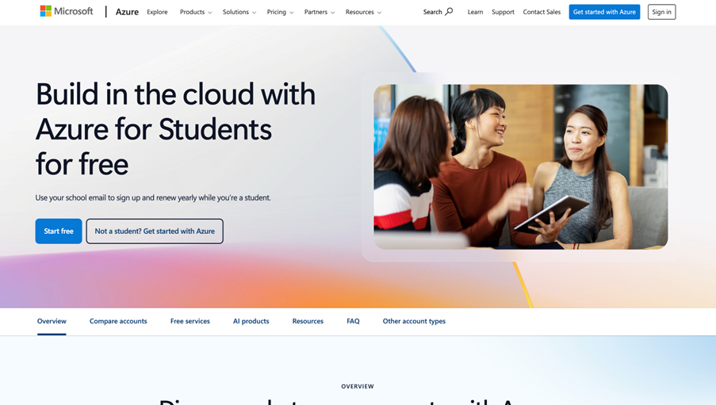

Pri ustvarjanju virtualne naprave je bilo treba izbrati konfiguracijo, ki je primerna za brezplačne oziroma čim cenejše storitve. Prvotno predvidena velikost Standard B1s ni bila dostopna, zato je bilo treba preveriti razpoložljive velikosti in regije. Po pregledu dovoljenj, registriranih resource providerjev in odprtih regij je bila izbrana regija Poland, kjer je bilo mogoče ustvariti virtualno napravo z ustrezno konfiguracijo. Uporabljena je bila velikost Standard B2ats, ker je bila razpoložljiva in primerna za izvajanje aplikacije.

**Slika:** težave pri uporabi B1

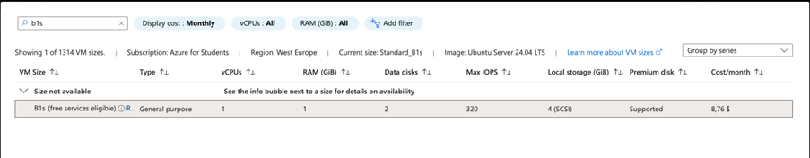

Pri pregledu pred ustvarjanjem virtualne naprave je bil disk spremenjen iz Premium SSD na Standard SSD, saj je ta možnost bolj ustrezala zahtevam projekta in omejitvam študentske naročnine.

**Slika:** podatki za ustvarjanje virtualnega stroja

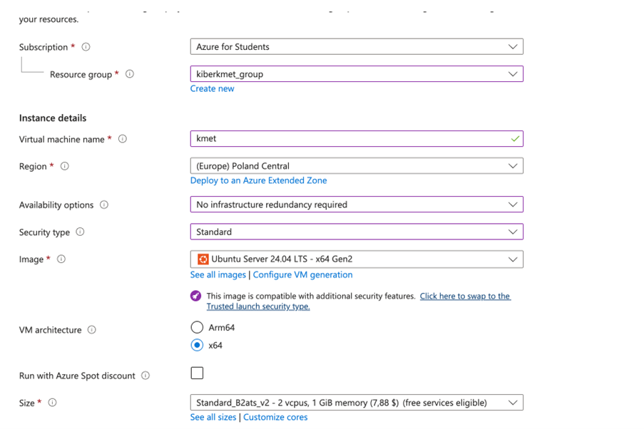


## Dostop do strežnika

Za prijavo na virtualno napravo je bil uporabljen dostop prek SSH z uporabniškim imenom `kmet`:

```bash
ssh kmet@20.215.65.21
```

Namesto prijave s SSH public key je bila uporabljena prijava z geslom. Po uspešni povezavi na strežnik so bile nameščene osnovne sistemske odvisnosti, Git, Docker in Docker Compose.


Ker je imela virtualna naprava omejeno količino pomnilnika, je bil dodan še swap prostor:

```bash
sudo fallocate -l 1G /swapfile
sudo chmod 600 /swapfile
sudo mkswap /swapfile
sudo swapon /swapfile
echo '/swapfile none swap sw 0 0' | sudo tee -a /etc/fstab
```

S tem je strežnik dobil dodatni navidezni pomnilnik, kar pomaga pri izvajanju Docker kontejnerjev na manjši virtualni napravi.

**Slika:** Ustvarjena virtualni stroj

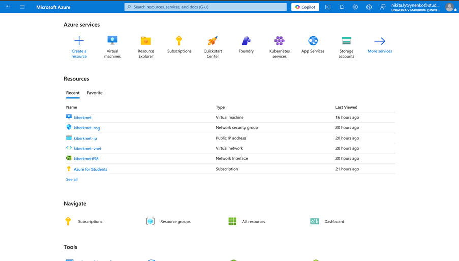

**Slika:** Nadzorna plošča za svoje virtualne stroje

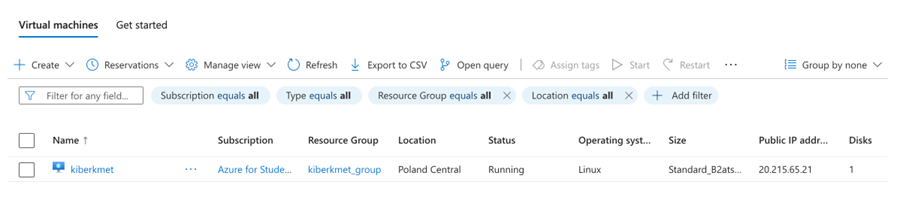


## Port forwarding in omrežna pravila

**Vprašanje:** Kje in kako omogočite "port forwarding"?

Port forwarding oziroma posredovanje vrat omogoča, da je storitev znotraj virtualne naprave dosegljiva iz javnega interneta. V Azure se to uredi z omrežnimi pravili v Network Security Group.

Pot do nastavitev:

```text
VM -> Networking -> Network settings -> kiberkmet-nsg -> Inbound rules
```

**Slika:** Azure **Networking** nastavitve in **Inbound rules** za **kiberkmet-nsg**


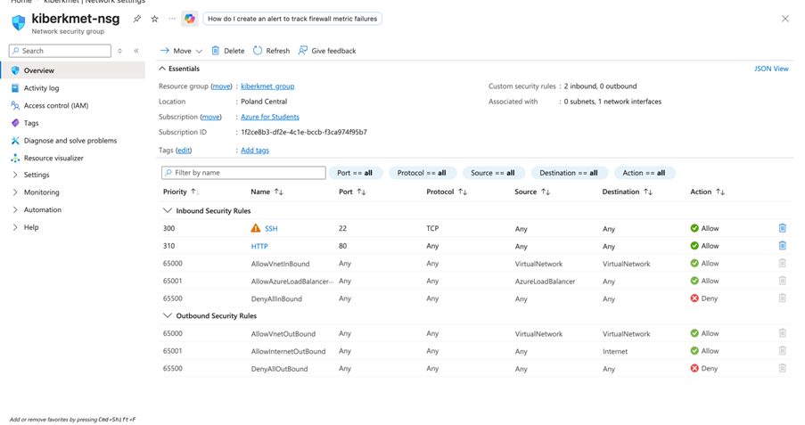


Za projekt so bila odprta naslednja vrata:

- `22` za SSH dostop do strežnika
- `80` za HTTP dostop do spletne aplikacije

Aplikacija je bila zato dostopna prek javnega naslova:

```text
http://20.215.65.21
```

**Slika:** prikaz odprtih pravil za vrata **22** in **80**

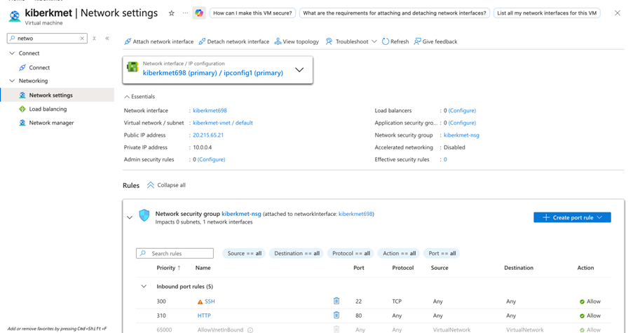


## Disk virtualne naprave

**Vprašanje:** Kakšen tip diska je bil dodan vaši navidezni napravi in kakšna je njegova kapaciteta?

Podatke o disku preverimo v Azure Portalu:

```text
VM -> Disks
```

**Slika:** Azure zavihek **Disks** z OS diskom  

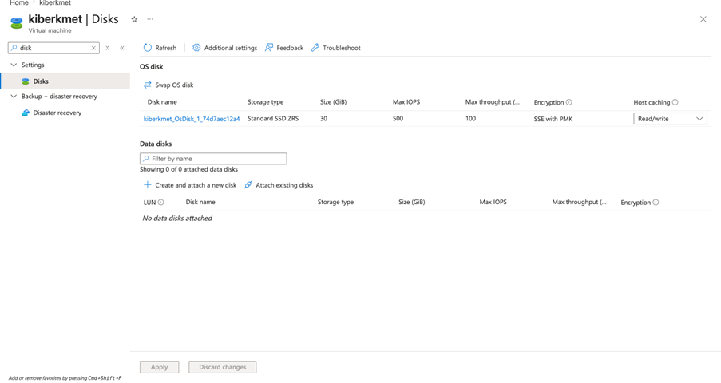

Virtualni napravi je bil dodan sistemski disk z naslednjimi lastnostmi:

- tip: Standard SSD ZRS
- kapaciteta: 30 GiB
- največji IOPS: 500

Standard SSD ZRS pomeni, da gre za standardni SSD disk z redundanco med conami. Tak disk zagotavlja zanesljivo shranjevanje podatkov operacijskega sistema in aplikacije, hkrati pa je primernejši za omejitve študentske naročnine kot dražje Premium možnosti.

**Slika:** podrobnosti diska, kjer so vidni tip **Standard SSD ZRS**, kapaciteta **30 GiB** in **500 IOPS**  
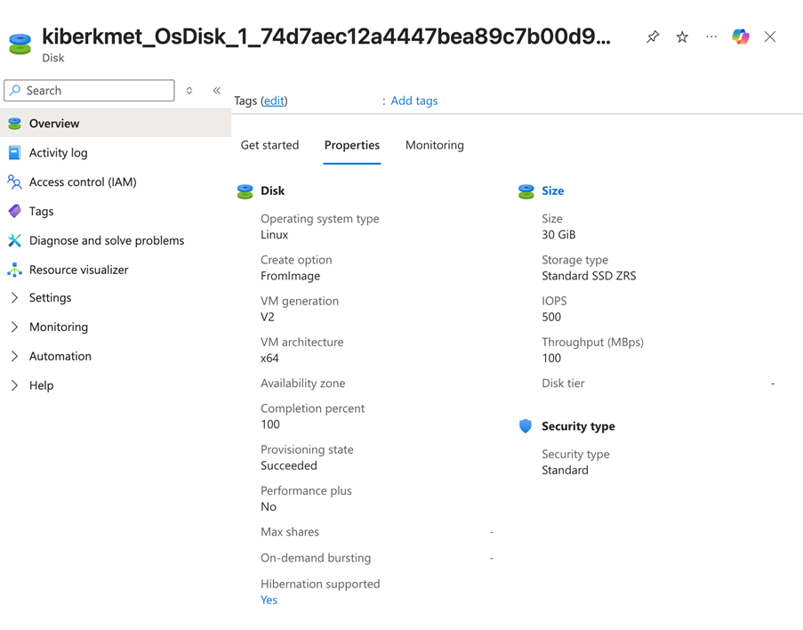

## Poraba virov v Azure for Students

**Vprašanje:** Kje preverimo stanje trenutne porabe virov v naši naročnini ("Azure for students")?

Stanje trenutne porabe virov preverimo v Azure Portalu:

```text
Subscriptions -> Azure for Students -> Usage + quotas
```

**Slika:** stran **Usage + quotas** v naročnini Azure for Students  

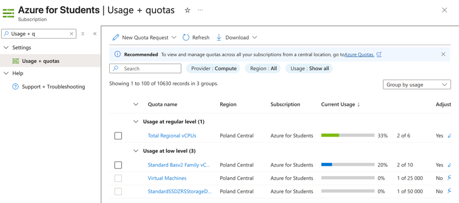

**Slika:** stran *Cost analysis* v naročnini Azure for Students  

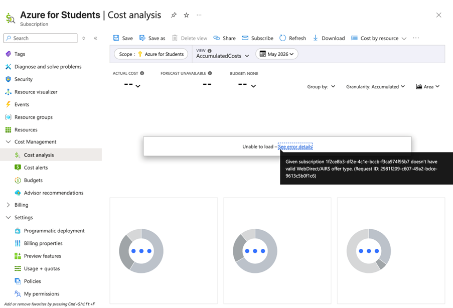


Tam so prikazane kvote in trenutna poraba virov, na primer število uporabljenih regionalnih vCPU-jev in število virtualnih naprav. Podatki o porabi so lahko vidni šele približno 24 ur po vzpostavitvi storitev.

Primer prikaza porabe:

- 2 od 6 regionalnih vCPU-jev
- 1 od 25.000 dovoljenih virtualnih naprav

## Git in prevzem projekta

Po pripravi strežnika je bil projekt prevzet iz Git repozitorija. Za dostop do projekta je bil na GitHubu ustvarjen ključ oziroma dostopni podatki za prevzem kode.

**Slika:** GitHub nastavitev ključa oziroma dostopa do repozitorija  
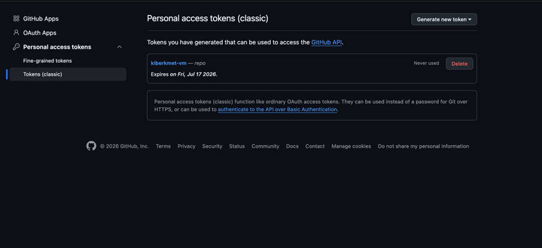

Za Azure namestitev je bila uporabljena posebna veja:

```text
azure
```

Ta veja je vsebovala prilagoditve, potrebne za zagon aplikacije na virtualni napravi.

**Slika:** terminal z izpisom Git veje **azure** ali ukazom **git branch**  
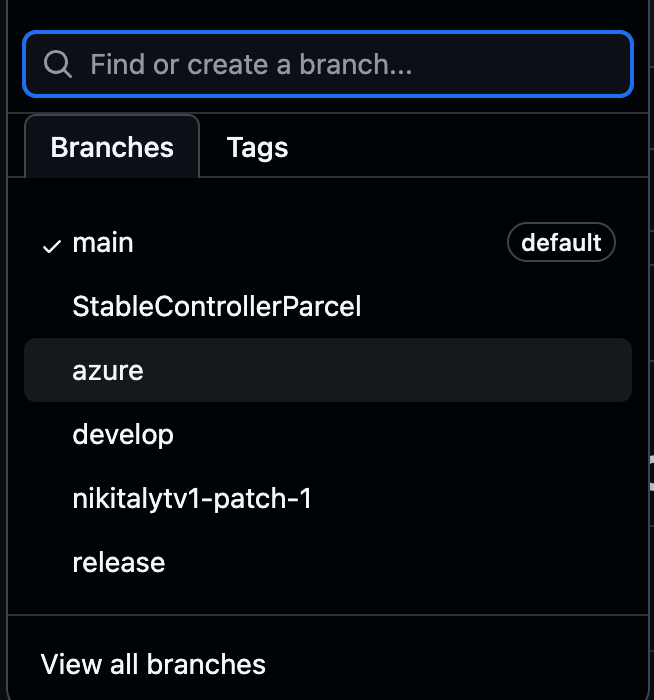

## Docker namestitev

Projekt je bil na strežniku zagnan z Docker Compose. Ker je imela virtualna naprava omejene vire, je bilo treba optimizirati `docker-compose.yml`, predvsem z omejitvami porabe pomnilnika za posamezne storitve.

**Slika:** Prenos repozitorija in izgradnja docker-ja na AZURE virtualnem stroju  
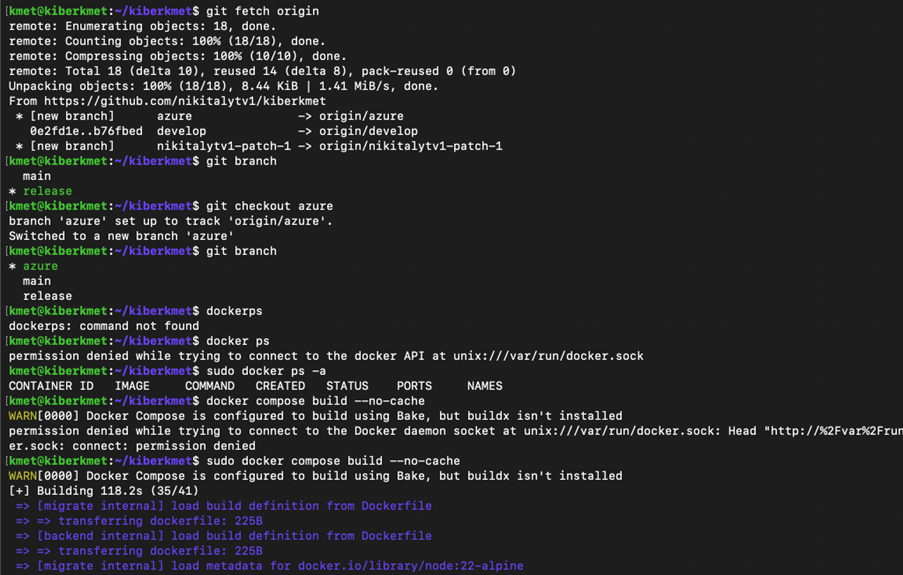

Konfiguracija vsebuje naslednje storitve:

- `db`: PostgreSQL z razširitvijo PostGIS
- `backend`: zaledni del aplikacije
- `migrate`: izvedba Prisma migracij
- `frontend`: uporabniški vmesnik, izpostavljen na vratih `80`

Primer uporabljene konfiguracije:

```yaml
services:
  db:
    image: postgis/postgis:15-3.3
    environment:
      POSTGRES_USER: ${POSTGRES_USER}
      POSTGRES_PASSWORD: ${POSTGRES_PASSWORD}
      POSTGRES_DB: ${POSTGRES_DB}
    volumes:
      - db_data:/var/lib/postgresql/data
      - ./backend/prisma/init.sql:/docker-entrypoint-initdb.d/init.sql
    healthcheck:
      test: ["CMD-SHELL", "pg_isready -U ${POSTGRES_USER} -d ${POSTGRES_DB}"]
      interval: 10s
      timeout: 5s
      retries: 5
    deploy:
      resources:
        limits:
          memory: 400M

  backend:
    build: ./backend
    ports:
      - "5001:5000"
    depends_on:
      db:
        condition: service_healthy
    env_file:
      - ./backend/.env
    environment:
      DATABASE_URL: postgresql://${POSTGRES_USER:-postgres}:${POSTGRES_PASSWORD:-postgres}@db:5432/${POSTGRES_DB:-kiberkmet}
      NODE_ENV: production
    deploy:
      resources:
        limits:
          memory: 256M

  migrate:
    build: ./backend
    command: npx prisma migrate deploy
    depends_on:
      db:
        condition: service_healthy
    environment:
      DATABASE_URL: postgresql://${POSTGRES_USER:-postgres}:${POSTGRES_PASSWORD:-postgres}@db:5432/${POSTGRES_DB:-kiberkmet}

  frontend:
    build:
      context: ./frontend
    ports:
      - "80:80"
    depends_on:
      - backend
    deploy:
      resources:
        limits:
          memory: 64M

volumes:
  db_data:
```

Glavna sprememba je bila, da se v Dockerju ne zaganjata samo podatkovna baza in backend, ampak tudi frontend. Frontend je izpostavljen na vratih `80`, zato lahko uporabnik do aplikacije dostopa neposredno prek javnega IP naslova virtualne naprave.

Dodane so bile tudi omejitve pomnilnika:

- podatkovna baza: `400M`
- backend: `256M`
- frontend: `64M`

To zmanjša možnost, da bi Docker kontejnerji porabili preveč pomnilnika in povzročili nestabilnost virtualne naprave.

**Slika:** izpis **docker ps**, kjer so vidni frontend, backend in podatkovna baza  
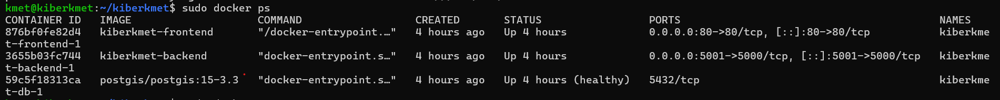

## Posebnost pri HTTP okolju

Pri uporabi aplikacije prek HTTP se je pojavila težava z uporabo `crypto.randomUUID`, saj določene funkcije Web Crypto API niso vedno na voljo v nezaščitenem HTTP okolju. Zato je bila dodana rezervna rešitev, ki uporabi `Math.random` in trenutni čas, kadar `crypto.randomUUID` ni na voljo.

```js
const tempId =
  crypto.randomUUID?.() ??
  Math.random().toString(36).slice(2) + Date.now().toString(36);
```

S tem aplikacija še vedno ustvari začasni identifikator tudi v okolju, kjer `crypto.randomUUID` ni podprt.


## Preverjanje backend dostopa

Dostop do backend dela aplikacije je bil preverjen tudi prek orodja Postman. Na ta način je bilo mogoče preveriti, ali API na virtualni napravi pravilno odgovarja na zahteve in ali je komunikacija med frontend delom, backend delom in podatkovno bazo pravilno vzpostavljena.

**Slika:** Postman zahteva na backend API virtualne naprave  
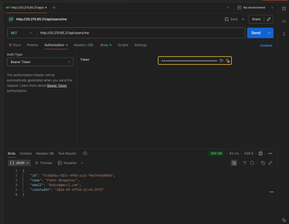

## Povezava na spletno mesto

**Slika:** prikaz login strani 

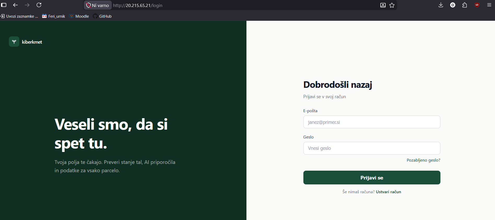


## Povezave na stroj

**Slika:** prijava 1. uporabnika

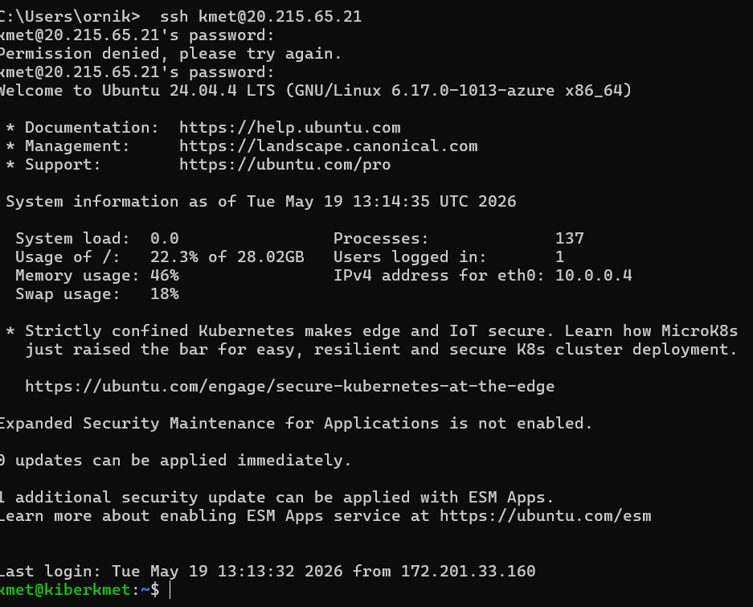

**Slika:** prijava 2. uporabnika

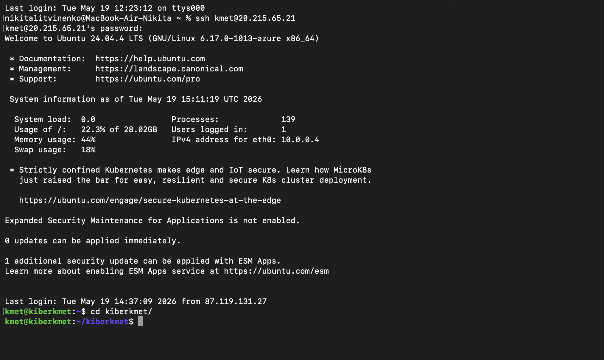

**Slika:** prijava 3. uporabnika

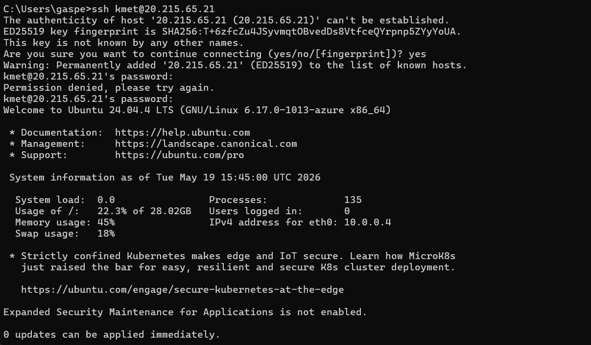

**Slika:** izpis vseh prijav na virtualni stroj
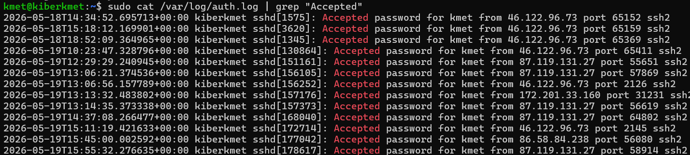

