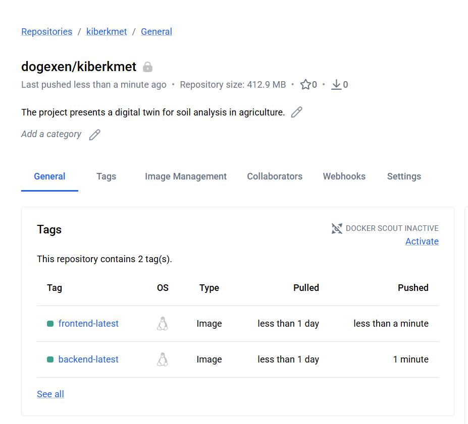
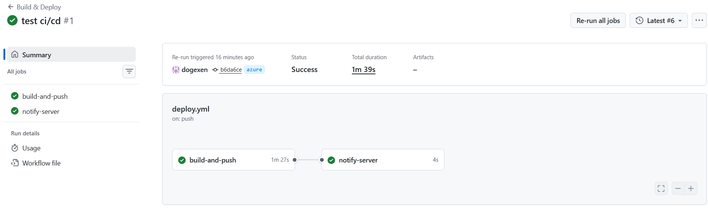
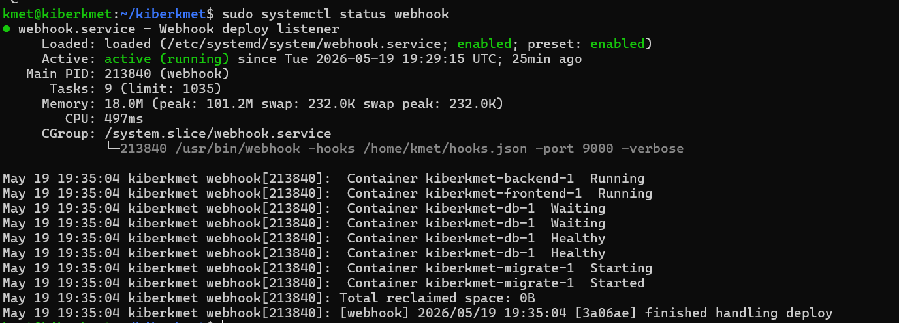
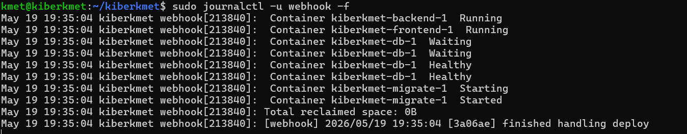

# Projektna naloga 3 - CI/CD z Docker Hub in GitHub Actions
 
## 1. Docker Hub Container Registry
 
### Ustvaritev računa in repozitorija
 
Vodja mikro-skupine je ustvaril brezplačen račun na [hub.docker.com](https://hub.docker.com) z uporabniškim imenom `dogexen`. V brezplačni različici Docker Hub omogoča en zasebni repozitorij, zato smo obe Docker sliki (backend in frontend) shranili v skupni repozitorij `dogexen/kiberkmet` z različnima tagoma (`backend-latest` in `frontend-latest`).
 
### CLI ukazi za Docker Hub
 
Spodaj so dokumentirani ukazi, potrebni za delo z Docker Hub container registry:
 
```bash
# Prijava v Docker Hub
docker login -u dogexen
 
# Gradnja Docker slike za backend
docker build -t dogexen/kiberkmet:backend-latest ./backend
 
# Gradnja Docker slike za frontend (production build)
docker build -t dogexen/kiberkmet:frontend-latest --target builder ./frontend
 
# Nalaganje slik na Docker Hub
docker push dogexen/kiberkmet:backend-latest
docker push dogexen/kiberkmet:frontend-latest
```
 

 
---
 
## 2. GitHub Actions Workflow
 
### Opis workflowa
 
V repozitoriju smo ustvarili workflow datoteko `.github/workflows/deploy.yml`, ki se proži ob vsakem `push` na vejo `azure`. Workflow je sestavljen iz dveh zaporednih jobov:
 
1. **`build-and-push`** - zgradi Docker sliki in ju naloži na Docker Hub
2. **`notify-server`** - pošlje webhook sporočilo na Azure VM (izvede se samo, če se je prvi job uspešno zaključil)
 
### Vsebina workflow datoteke
 
```yaml
name: Build & Deploy
 
on:
  push:
    branches: [azure]
 
jobs:
  build-and-push:
    runs-on: ubuntu-latest
    steps:
      - name: Checkout code
        uses: actions/checkout@v4
 
      - name: Log in to Docker Hub
        uses: docker/login-action@v3
        with:
          username: ${{ secrets.DOCKERHUB_USERNAME }}
          password: ${{ secrets.DOCKERHUB_TOKEN }}
 
      - name: Build & push backend
        uses: docker/build-push-action@v5
        with:
          context: ./backend
          push: true
          tags: ${{ secrets.DOCKERHUB_USERNAME }}/kiberkmet:backend-latest
 
      - name: Build & push frontend
        uses: docker/build-push-action@v5
        with:
          context: ./frontend
          target: builder
          push: true
          tags: ${{ secrets.DOCKERHUB_USERNAME }}/kiberkmet:frontend-latest
 
  notify-server:
    needs: build-and-push
    runs-on: ubuntu-latest
    steps:
      - name: Send webhook to VM
        uses: distributhor/workflow-webhook@v3
        with:
          webhook_url: http://${{ secrets.VM_HOST }}:9000/hooks/deploy
          webhook_secret: ${{ secrets.WEBHOOK_SECRET }}
```
 
### GitHub Secrets
 
Za varno hranjenje občutljivih podatkov smo uporabili GitHub Secrets (Settings -> Secrets and variables -> Actions):
 
| Secret | Opis |
| `DOCKERHUB_USERNAME` | Uporabniško ime Docker Hub računa |
| `DOCKERHUB_TOKEN` | Personal Access Token za Docker Hub |
| `VM_HOST` | Javni IP naslov Azure VM (`20.215.65.21`) |
| `WEBHOOK_SECRET` | Naključen HMAC ključ za podpisovanje webhook zahtev |
 

 
### Možne razširitve workflowa
 
Poleg obstoječega deploy workflowa bi lahko za projekt dodali naslednje GitHub Actions workflowe:
 
- **Linter workflow** - ob vsakem pull requestu preveri kodo s ESLint za frontend in backend (prepreči merge slabe kode)
- **Test workflow** - zažene enote (unit) in integracijske teste pred buildanjem slike, tako zagotovimo da se v produkcijo ne prebije pokvarjena koda
- **Security scan workflow** - z orodjem trivy skenira Docker slike za znane ranljivosti (CVE) preden se naložijo na Docker Hub
- **PR preview workflow** - ob vsakem pull requestu zgradi sliko in jo namesti na ločeno testno okolje, da pregled kode poteka na živem sistemu
 
---
 
## 3. Webhook
 
### Namestitev in konfiguracija
 
Na Azure VM smo namestili orodje `webhook` (adnanh/webhook):
 
```bash
sudo apt install webhook -y
```
 
Ustvarili smo konfiguracijsko datoteko `~/hooks.json`:
 
```json
[
  {
    "id": "deploy",
    "execute-command": "/home/kmet/deploy.sh",
    "command-working-directory": "/home/kmet",
    "trigger-rule": {
      "match": {
        "type": "payload-hmac-sha256",
        "secret": "<WEBHOOK_SECRET>",
        "parameter": { "source": "header", "name": "X-Hub-Signature-256" }
      }
    }
  }
]
```
 
Webhook listener smo nastavili kot systemd servis (`/etc/systemd/system/webhook.service`), ki se samodejno zažene ob zagonu VM in posluša na portu `9000`.
 
```bash
sudo systemctl enable --now webhook
```
 

 
### Deploy skripta
 
Skripta `~/deploy.sh` ob vsakem prejetem webhook sporočilu:
1. Prenese najnovejše Docker slike iz Docker Hub
2. Ponovno zažene containerje
3. Počisti neuporabljene slike
 
```bash
#!/bin/bash
cd /home/kmet/kiberkmet
docker compose pull
docker compose up -d --remove-orphans
docker image prune -f
```
 

 
### Varnostne luknje in pomisleki
 
Pri uporabi webhookov obstaja več varnostnih pomislekov:
 
**1. Nešifriran prenos (HTTP)**
Webhook poslušamo na `http://`, kar pomeni da se podatki (vključno s podpisom) prenašajo nešifrirano. Napadalec v omrežju bi lahko prestregel zahtevo.
*Rešitev:* Postaviti nginx reverse proxy z Let's Encrypt TLS certifikatom pred webhook listenerjem, tako da promet poteka čez `https://`.
 
**2. HMAC podpisovanje**
Implementirali smo HMAC-SHA256 podpisovanje zahtev. GitHub Actions podpiše telo zahteve s skupnim secretom, webhook listener pa podpis preveri preden izvede skripto. S tem preprečimo, da bi kdorkoli drug sprožil deploy.
 
**3. Izpostavljenost porta 9000**
Port 9000 je odprt vsem (`0.0.0.0`). Napadalec bi lahko poskušal pošiljati zahteve na webhook endpoint.
*Rešitev:* V Azure NSG omejiti dovoljene izvorne IP naslove na znane GitHub Actions IP range.
 
**4. Izvajanje skript z elevated pravicami**
Webhook izvaja `deploy.sh` kot sistemski uporabnik. Napačna skripta ali ranljivost bi lahko povzročila škodo.
*Rešitev:* Zagnati webhook service pod ločenim uporabnikom z minimalnimi pravicami (samo Docker skupina, brez sudo).